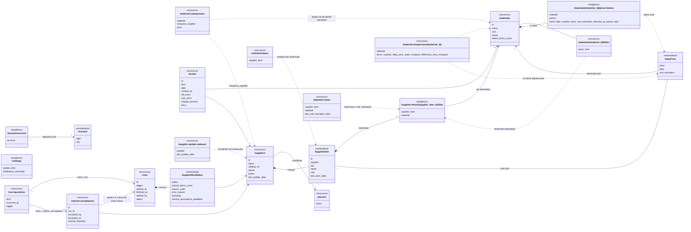

# Лабораторна робота № 4. Проєктування REST API за специфікацією

**Дисципліна:** Інформаційні системи
**Студент:** Бублик Володимир, група КН-32
**Тема індивідуального проєкту:** Інформаційна система моніторингу цін постачальників матеріалів
**Репозиторій:** https://github.com/lrijht/supplier-price-monitoring-is
**Кодинговий агент:** Claude Code (Anthropic)
**Дата виконання:** 28.10–30.10.2026

## 1. Мета роботи

Опанувати API-first підхід у SDD і перехід від затверджених вимог до формального контракту REST API. Набути практичних навичок декомпозиції предметної області на ресурси, проєктування URI та HTTP-операцій, визначення схем запитів і відповідей, формування OpenAPI specification, перевірки позитивних і негативних сценаріїв через mock API та проведення API-GATE до початку програмної реалізації. Серверний код у роботі не пишеться: реалізація – у лабораторній роботі № 5 за TDD.

## 2. Вхідні артефакти і результати

Вхідні дані – артефакти лабораторних робіт № 2 і № 3: `spec/srs.md` версії 1.7 (69 функціональних і 30 нефункціональних вимог, 67 сценаріїв BDD, 16 сценаріїв використання), глосарій, матриця простежуваності, план із 51 тікета (GitHub Issues #1…#51), календарний план і реєстр ризиків.

Результати роботи за переліком методички:

| № | Результат | Де в репозиторії |
|---|---|---|
| 1 | Модель REST-ресурсів | `docs/api/resources.md`, розділ 2; діаграма `docs/api/resources.mmd`, `docs/api/resources.png` |
| 2 | Таблиця простежуваності REQ-ID та API operations | `docs/api/resources.md`, розділ 3; `x-req-ids` в `spec/openapi.yaml`; розділ 7 цього звіту |
| 3 | OpenAPI specification | `spec/openapi.yaml` (OpenAPI 3.1.0) |
| 4 | Схеми запитів і відповідей | `spec/openapi.yaml`, `components/schemas` (65 схем); поля – `docs/api/resources.md`, розділ 2.1 |
| 5 | Єдина модель помилок | схеми `Problem`, `ValidationProblem`, `ProblemCode`; `docs/api/resources.md`, розділ 4 |
| 6 | Позитивні сценарії | `docs/api/scenarios.md`, `tests/contract/scenarios.json`: П-01…П-37 |
| 7 | Негативні сценарії | там само: Н-01…Н-45 |
| 8 | Результат автоматичної валідації | `docs/api/validation.md` |
| 9 | Працюючий mock API | `package.json` (`npm run api:mock`), `docs/api/mock-run.md` |
| 10 | Оновлена матриця простежуваності | `spec/traceability.md`: колонка «API», номери нових issues |
| 11 | Запис рішення API-GATE | `logs/gates.md`, `logs/2026-10-29-api-gate.md` |

Додатково змінено специфікацію двома адендумами: `spec/addendum-A03.md` (SRS 1.8) і `spec/addendum-A04.md` (SRS 1.9). Додано тікети T-52…T-59 (`docs/tickets.md`, issues #52…#59) і записи дев'яти сесій агента в `logs/2026-10-28-*.md` і `logs/2026-10-29-*.md`.

## 3. Порядок роботи

Робота йшла тими самими кроками, що й попередні: агент готує зміни в окремій гілці і зупиняється, людина переглядає `git diff`, комітить і зливає гілку в `main` через `git merge --no-ff`. Кожна сесія агента має запис у `/logs/`.

| Крок | Що зроблено | Хто | Гілка |
|---|---|---|---|
| 1 | Адендум A-03: REST API у специфікації (SRS 1.8) | агент, рішення людини | `spec/addendum-a03` |
| 2 | Чернетка моделі ресурсів, таблиця REQ → операції, прогалини ПА-1…ПА-23 | агент | `agent/api-resources` |
| 3 | Адендум A-04: прогалини з новою поведінкою (SRS 1.9) | агент, рішення людини | `spec/addendum-a04` |
| 4 | Остаточна модель ресурсів і контракт `spec/openapi.yaml` | агент | `agent/api-contract` |
| 5 | Інструменти, валідація, mock, сценарії, прогін | агент | `agent/api-mock` |
| 6 | Незалежна перевірка контракту окремою сесією | агент | `log/api-review` |
| 7 | API-GATE, перша перевірка: REVISE | людина | `log/gate-api-revise` |
| 8 | Виправлення зауважень РА-01…РА-16 | агент | `agent/api-revise` |
| 9 | API-GATE, повторна перевірка: GO | людина | `log/api-gate` |
| 10 | Тікети, виправлення і колонка «API» в матриці | агент | `agent/api-traceability` |

## 4. Конфлікт зі специфікацією і адендум A-03

SRS 1.7 програмного інтерфейсу не передбачала: п. 3.1.4 «Програмні інтерфейси для інших систем» мав позначку «не застосовно», а п. 2.7 відносив «публічний програмний інтерфейс (API) для інших систем» до того, що не входить у поточну версію (рішення Р-39). Контракт API без зміни вимог суперечив би SRS, а правило проєкту забороняє агентові розв'язувати такі суперечності самостійно.

Тому першим кроком людина ухвалила рішення Р-117, і агент оформив його адендумом A-03:
- система надає REST API з префіксом `/api/v1` і форматом JSON у тому самому процесі, що й вебінтерфейс (REQ-NF-014);
- вебінтерфейс не змінюється: сторінки, як і раніше, формуються на сервері (REQ-NF-015);
- API дає ті самі функції, що й екрани, з тими самими правами ролей і тією самою сесією;
- облікових записів через API не створюють (REQ-F-006), записів не видаляють (REQ-F-010);
- ключів, токенів і вебхуків для зовнішніх систем немає;
- контракт `spec/openapi.yaml` після API-GATE змінюється лише адендумом.

Адендум додав REQ-NF-031 і BDD-068 (доступ до API за ролями), змінив пп. 2.1, 2.4, 2.5, 2.7, 3.1.4 і позначив, що рішення Р-39 частково змінено. До глосарію додано терміни «REST API», «Контракт API», «Модель помилок API», «Обліковий запис» і рядки «В API:» з англійськими назвами 30 термінів. Задум у аспекті «Де» людина доповнила окремим комітом `b0122a3`.

## 5. Функціональні вимоги, доступні через API

Агент розібрав усі 71 функціональну вимогу SRS 1.9 (`docs/api/resources.md`, розділ 1):

| Група | Кількість | Приклади |
|---|---|---|
| Операція API | 35 | вхід і вихід, ведення постачальників і матеріалів, прив'язка, порівняння, історія, стрічка змін, налаштування, ручний запуск, прийняття нового обсягу |
| Внутрішня поведінка | 35 | запуск за розкладом, доганяння, розбір сторінок, правила подій і порогу, атомарність запису; через API видно лише результат: статуси запуску, ціни, події |
| Поза API | 1 | REQ-F-006 – облікові записи створює лише команда початкового налаштування |

Дві вимоги з групи «операція API» (REQ-F-049, REQ-F-063) мають і внутрішню частину. Скрипт агента перевірив, що кожна REQ-F є в таблиці рівно один раз, а всі згадані REQ і BDD існують у SRS.

## 6. Модель ресурсів

Модель має 20 ресурсів, кожен зіставлено з терміном глосарію (рисунок 1). Правила іменування:
- колекції – множиною в kebab-case (`/suppliers`, `/supplier-items`); підресурс-одинак – в однині (`/sessions/current`, `/supplier-items/{supplier_item_id}/link`, `/materials/{material_id}/price-history`, `/settings`);
- поля й значення перелічень – snake_case; кожне поле зіставлено з полем словника даних SRS, п. 3.8 (`resources.md`, розділ 2.1);
- шлях колекції названо за елементом, а не за цілим: «подія» – `/events`, «порівняння матеріалу» – `/material-comparisons`; назви цілого з глосарію (стрічка змін, загальний список порівняння) – у тегах і назвах схем;
- ідентифікатори – цілі числа, позиція постачальника адресується лише ідентифікатором.

Без власної адреси (вкладені у відповіді інших ресурсів) – обліковий запис, позиція постачальника, ціна дня і статус постачальника в запуску. Окремої колекції цін дня немає: жоден екран не показує ціни дня без обробки, а така колекція була б новою функцією.



*Рисунок 1 – Модель ресурсів REST API (`docs/api/resources.mmd`).*

## 7. URI, HTTP-методи і простежуваність REQ-ID

Контракт має 21 шлях і 28 операцій. Таблиця нижче – скорочена таблиця простежуваності «операція → REQ-ID»; повна, з параметрами, тілами, кодами і BDD, – у `docs/api/resources.md`, розділ 3. Колонка «Роль»: «обидві» – менеджер і адміністратор, «адмін» – лише адміністратор.

| # | Метод і URI | `operationId` | Роль | Основні REQ-ID |
|---|---|---|---|---|
| 1 | POST `/sessions` | `createSession` | без сесії | REQ-F-001, REQ-NF-021 |
| 2 | GET `/sessions/current` | `getCurrentSession` | обидві | REQ-F-071 |
| 3 | DELETE `/sessions/current` | `deleteCurrentSession` | обидві | REQ-F-002 |
| 4 | GET `/suppliers` | `listSuppliers` | обидві | REQ-F-007, REQ-F-068, REQ-F-070 |
| 5 | POST `/suppliers` | `createSupplier` | адмін | REQ-F-007, REQ-NF-006 |
| 6 | GET `/suppliers/{supplier_id}` | `getSupplier` | адмін | REQ-F-007 |
| 7 | PATCH `/suppliers/{supplier_id}` | `updateSupplier` | адмін | REQ-F-007, REQ-F-010, REQ-F-011, REQ-F-056 |
| 8 | GET `/parsers` | `listParsers` | адмін | REQ-F-007, REQ-NF-006 |
| 9 | GET `/materials` | `listMaterials` | обидві | REQ-F-008, REQ-F-049, REQ-F-069, REQ-F-070 |
| 10 | POST `/materials` | `createMaterial` | адмін | REQ-F-008 |
| 11 | GET `/materials/{material_id}` | `getMaterial` | адмін | REQ-F-008 |
| 12 | PATCH `/materials/{material_id}` | `updateMaterial` | адмін | REQ-F-008, REQ-F-009, REQ-F-010, REQ-F-051 |
| 13 | GET `/materials/{material_id}/links` | `listMaterialLinks` | адмін | REQ-F-069 |
| 14 | GET `/unlinked-items` | `listUnlinkedItems` | адмін | REQ-F-012 |
| 15 | GET `/attention-items` | `listAttentionItems` | адмін | REQ-F-017, REQ-F-066 |
| 16 | PUT `/supplier-items/{supplier_item_id}/link` | `putSupplierItemLink` | адмін | REQ-F-013…REQ-F-016, REQ-F-048, REQ-F-050 |
| 17 | DELETE `/supplier-items/{supplier_item_id}/link` | `deleteSupplierItemLink` | адмін | REQ-F-015, REQ-F-066 |
| 18 | GET `/material-comparisons` | `listMaterialComparisons` | обидві | REQ-F-035, REQ-F-059 |
| 19 | GET `/material-comparisons/{material_id}` | `getMaterialComparison` | обидві | REQ-F-036…REQ-F-039, REQ-F-065 |
| 20 | GET `/materials/{material_id}/price-history` | `getMaterialPriceHistory` | обидві | REQ-F-040, REQ-F-041 |
| 21 | GET `/events` | `listEvents` | обидві | REQ-F-042, REQ-F-058 |
| 22 | GET `/supplier-update-statuses` | `listSupplierUpdateStatuses` | обидві | REQ-F-034 |
| 23 | GET `/settings` | `getSettings` | адмін | REQ-F-019, REQ-F-043 |
| 24 | PATCH `/settings` | `updateSettings` | адмін | REQ-F-019, REQ-F-043, REQ-F-055 |
| 25 | POST `/runs` | `createRun` | адмін | REQ-F-020, REQ-F-021, REQ-F-063 |
| 26 | GET `/runs/{run_id}` | `getRun` | адмін | REQ-F-024…REQ-F-026, REQ-F-032, REQ-F-033 |
| 27 | GET `/run-log-entries` | `listRunLogEntries` | адмін | REQ-F-018, REQ-F-033, REQ-NF-019 |
| 28 | POST `/volume-acceptances` | `createVolumeAcceptance` | адмін | REQ-F-031, REQ-F-047, REQ-F-052 |

Крім перелічених, усі 18 операцій адміністратора мають REQ-F-003, REQ-F-004, REQ-F-005 (права ролей і відповідь «немає доступу»), а операції сесії і DELETE – REQ-NF-031.

Методи використано послідовно: GET – читання; POST – створення (сесії, постачальника, матеріалу, запуску, прийняття обсягу); PATCH – часткова зміна, деактивація (`active: false`) і повторна активація; PUT – прив'язка або перев'язка позиції; DELETE – лише вихід і зняття прив'язки. DELETE на адресах постачальників і матеріалів відповідає 405: записи не видаляються (REQ-F-010). Ручний запуск – `POST /runs` з відповіддю 202, бо запуск асинхронний (до 5 хвилин, REQ-NF-008).

Перевірка за критерієм REQ-NF-031: кожен з 11 екранів REQ-NF-003 має операцію, кожна дія вимог REQ-F-001…REQ-F-069 (крім створення облікових записів) теж, операцій створення облікових записів і видалення записів немає.

## 8. Прогалини моделі ресурсів і адендум A-04

Чернетка моделі ресурсів виявила 23 місця, де SRS 1.8 для API нічого не визначає (ПА-1…ПА-23, `docs/api/resources.md`, розділ 5). Агент жодне з них не вирішував сам: записав питання і варіанти. Людина розділила їх на два види.

**Нова поведінка – адендум A-04 (SRS 1.9).** Рішення Р-118…Р-122:

| Р | ПА | Рішення | Зміни в SRS |
|---|---|---|---|
| Р-118 | ПА-1, ПА-2 | зняття прив'язки і вихід не є видаленням записів, DELETE для них дозволено | уточнено REQ-NF-031 і рядок Р-117 |
| Р-119 | ПА-3, ПА-16 | терміни «Сесія» (session) і «Запис журналу оновлень» (run log entry) | глосарій |
| Р-120 | ПА-13 | запуск, що ще не завершився, має п'ятий загальний статус «триває» і видний у журналі одразу | REQ-F-032…REQ-F-034, Д.7, Д.8, UC-05, UC-13, UC-14, BDD-069 |
| Р-121 | ПА-14 | менеджер через API читає списки матеріалів і постачальників, зокрема деактивованих, для вибору на екрані історії й фільтрів стрічки | нова REQ-F-070, BDD-070 |
| Р-122 | ПА-19 | користувач через API читає свою поточну сесію: логін і роль | нова REQ-F-071 |

Без Р-121 вимога REQ-F-049 через API не виконувалась: менеджер не міг дізнатися ідентифікатор деактивованого матеріалу. Без Р-120 не було відомо, що показує запуск у журналі, поки він триває.

**Проєктні рішення контракту без зміни SRS:** назви полів (ПА-4), значення перелічень (ПА-5), формат чисел (ПА-6: ціни – рядок `"1250.50"`, відсотки й поріг – число JSON), `null` для відсутніх значень (ПА-7), формат часу `"03:30"` (ПА-8), тексти помилок (ПА-9), поля моделі помилок (ПА-10), обгортка сторінки `{items, page, page_size, total_items, total_pages}` (ПА-15), цілі ідентифікатори (ПА-18), `Content-Type: application/json` і cookie `SameSite=Lax` (ПА-20) та інші.

## 9. Схеми запитів і відповідей

`components/schemas` містить 65 схем:
- представлення ресурсів: `Session`, `Supplier`, `SupplierForManager`, `Material`, `MaterialForManager`, `SupplierItem`, `Link`, `MaterialComparison`, `ComparisonListRow`, `PriceHistory`, `Event`, `Run`, `SupplierRunStatus`, `RunLogEntry`, `Settings`, `VolumeAcceptance` тощо;
- тіла запитів: `SessionCreate`, `SupplierCreate`, `SupplierUpdate`, `MaterialCreate`, `MaterialUpdate`, `LinkPut`, `SettingsUpdate`, `VolumeAcceptanceCreate`; усі з `additionalProperties: false`, тож невідоме поле дає 422;
- сторінки: `SupplierPage`, `MaterialPage`, `EventPage`, `RunLogEntryPage` та інші на основі `PageMeta`;
- значення: `Price` (більше 0), `Amount` (не менше 0), `Percent`, переліки `Role`, `RunStatus`, `RunTrigger`, `SupplierRunStatusValue`, `EventKind`, `HistoryPeriod`, `ReasonCode`;
- помилки: `Problem`, `ValidationProblem`, `FieldError`, `ProblemCode`.

Менеджер у списках `GET /suppliers` і `GET /materials` отримує коротку схему лише з `id`, `name`, `active`: без адреси каталогу й розбирача (REQ-F-070) і без даних адміністративних екранів.

Поріг сповіщень задано числом від 0,1 до 50 без `multipleOf`: крок 0,1 перевіряє сервер (розділ 13, РА-01).

## 10. Єдина модель помилок

Кожна відповідь з помилкою, і 4xx, і 5xx, має формат `application/problem+json` (RFC 9457):

| Поле | Зміст |
|---|---|
| `type` | завжди `about:blank`: тип визначає `code` |
| `title` | українська назва статусу HTTP |
| `status` | код HTTP |
| `detail` | пояснення цього випадку українською; дослівні тексти SRS не змінено |
| `code` | машинний код помилки (16 значень `ProblemCode`) |
| `errors` | для 422 і конфліктів, пов'язаних із полем: `field`, `code`, `detail` |

Приклад (403, BDD-068):

```json
{
  "type": "about:blank",
  "title": "Заборонено",
  "status": 403,
  "detail": "немає доступу",
  "code": "forbidden"
}
```

Коди і правила:
- 401 `unauthenticated`, `invalid_credentials`;
- 403 `forbidden` з текстом «немає доступу» (REQ-F-005);
- 404 `not_found`;
- 405 `method_not_allowed` (описано в `info.description`, бо OpenAPI не описує методів, яких адреса не має);
- 409 – запит коректний, але суперечить стану системи: `supplier_name_taken`, `material_name_taken`, `unit_locked` («одиницю не можна змінити: є ціни або прив'язки»), `link_units_differ`, `material_supplier_already_linked`, `material_inactive`, `run_in_progress` («оновлення вже триває»), `volume_acceptance_unavailable`;
- 415 `unsupported_media_type` – запит з тілом не в JSON;
- 422 `validation_failed` – некоректний запит, подробиці в `errors` (`required`, `invalid_type`, `catalog_url_invalid`, `update_time_invalid`, `notification_threshold_out_of_range`, `period_invalid` тощо);
- 500 `internal_error` – на всіх 28 операціях, `detail` без подробиць збою, подробиці – у технічному журналі (REQ-NF-018).

Помилка не змінює стану системи. Перевірки йдуть у фіксованому порядку: 401 → 403 → 422 (параметри шляху і запиту) → 404 → 415 → 422 (тіло) → 409; 500 – у будь-який момент. Тому менеджер на адміністративній операції завжди отримує «немає доступу», а не «не знайдено», а `/suppliers/abc` – 422, а не 404.

## 11. OpenAPI specification

`spec/openapi.yaml` – OpenAPI 3.1.0, понад 3 000 рядків:
- `servers`: `http://localhost:8000/api/v1`; схема безпеки `cookieAuth` – cookie `spm_session`; для входу `security: []`;
- шість тегів за функціями п. 2.2 SRS і «Вхід і розмежування доступу»;
- у кожної операції – `operationId`, `summary`, `x-req-ids` (REQ-ID), `x-bdd` (де є), параметри, тіло, усі відповіді;
- спільні відповіді `Unauthorized`, `Forbidden`, `NotFound`, `UnsupportedMediaType`, `ValidationFailed`, `InternalServerError` і параметри `page`, `active`, ідентифікатори;
- іменовані приклади для кожної відповіді, окремий приклад на кожен `code` помилки: з них працює mock. Дані прикладів узято з критеріїв прийняття SRS (постачальники «Альфа», «Бета», матеріал «ЛДСП Білий 18 мм», поріг 1 %, запуск 2026-10-05 о 03:30:05).

Розширення `x-req-ids` дає трасування прямо з контракту: з нього згенеровано колонку «API» матриці (розділ 16).

## 12. Автоматична валідація і mock API

Інструменти додано окремим комітом `chore:` (`8977db9`) з точними версіями в `package.json`:

| Інструмент | Версія | Скрипт | Призначення |
|---|---|---|---|
| Redocly CLI | 2.72.0 | `npm run api:lint` | валідатор OpenAPI з набором правил `recommended` |
| Prism (Stoplight) | 5.16.0 | `npm run api:mock` | mock-сервер з контракту на порту 4010 |

У `redocly.yaml` вимкнено два правила з поясненням: `info-license` (навчальний репозиторій без ліцензії) і `no-server-example.com` (єдиний сервер – локальне розгортання за REQ-NF-014).

Результат валідації після API-GATE: **0 помилок, 0 попереджень**.

```
validating spec/openapi.yaml...
spec/openapi.yaml: validated in 172ms

Woohoo! Your API description is valid. 🎉
```

Mock запускається з контракту без жодного рядка серверного коду. Prism відповідає за прикладами контракту, а потрібну відповідь обирає заголовок `Prefer: code=…` або `Prefer: code=…, example=…`. Некоректні запити (тип, межі, обов'язкові поля, відсутність cookie) Prism відхиляє сам, перевіряючи їх за схемами контракту.

Обмеження mock, записані в `docs/api/mock-run.md`:
- Prism віддає шляхи без префікса `/api/v1`, тож базова адреса mock – `http://127.0.0.1:4010`, а сервера в Лаб. 5 – `http://localhost:8000/api/v1`;
- 404 і 405 на невідомий шлях чи метод Prism віддає у власному форматі, тому для Н-07 і Н-08 проти mock перевіряється лише статус;
- на тіло, що не є JSON, Prism не відповідає зовсім, тому Н-27 проти mock пропускається.

## 13. Позитивні й негативні сценарії

Сценарії описано в `docs/api/scenarios.md` і в машинному вигляді в `tests/contract/scenarios.json` з тими самими ID. Кожен сценарій має REQ/BDD, запит (метод, шлях, заголовки, тіло), очікуваний статус і `code`, а також спосіб, яким його відтворює mock.

**Позитивні (37):** кожна з 28 операцій хоча б раз, зокрема вхід із cookie і `Location` (П-01), список постачальників для менеджера без адреси каталогу (П-05), деактивація постачальника (П-08), прив'язка і перев'язка (П-18, П-19), ручний запуск 202 і без активних постачальників 200 (П-27, П-28), межові значення порогу 0,1, 0,3, 0,5 і 50 (П-32…П-35), коротке представлення матеріалів для менеджера і фільтр `active=true` (П-36, П-37).

**Негативні (45):**

| Код | Сценарії | Що перевіряють |
|---|---|---|
| 401 | Н-01, Н-02 | без сесії; неправильний логін чи пароль |
| 403 | Н-03, Н-04, Н-29…Н-44 | менеджер на кожній з 18 операцій адміністратора (BDD-068, BDD-070) |
| 404 | Н-05…Н-07 | неіснуючий постачальник; зняття відсутньої прив'язки; невідома адреса |
| 405 | Н-08 | DELETE постачальника (REQ-F-010) |
| 409 | Н-09…Н-15, Н-28 | оновлення вже триває; одиниця з цінами; дубль назви й найменування; різні одиниці; друга позиція постачальника; деактивований матеріал; прийняття обсягу |
| 415 | Н-16 | тіло не в JSON |
| 422 | Н-17…Н-27 | поріг 0,05, 50,1 і 1,25, час «3:30»; адреса `ftp://`; `/suppliers/abc`; немає `period`; невідомий вид події; `page=abc`; невідоме поле; поле лише для читання; тіло не JSON |
| 500 | Н-45 | внутрішня помилка без подробиць |

Прогін виконує `tests/contract/run_mock_scenarios.py` – лише стандартна бібліотека Python, без нових залежностей. Скрипт перевіряє статус, `code`, пари `errors[].field`/`errors[].code`, обов'язкові й відсутні поля та заголовки, друкує таблицю і повертає код 1, якщо хоч один сценарій не пройшов. Базову адресу передають аргументом, тож у Лаб. 5 той самий файл піде проти реального сервера (`--target server`).

## 14. Перевірка контракту через mock

| Прогін | Дата | Сценаріїв | Результат | Що виявлено |
|---|---|---|---|---|
| 1 | 28.10.2026 | 50 | 49 пройшли, 1 ні | П-01: Prism відповідав 500 `Invalid character in header content ["Set-Cookie"]` |
| 2 | 29.10.2026 | 50 | 50 з 50 | після виправлення прикладу заголовка (`ecbbe66`) |
| 3 | 29.10.2026 | 82 | 81 пройшли, 0 не пройшли, 1 пропущено | після REVISE; Н-27 пропущено через обмеження Prism |

Причина збою П-01: приклад заголовка `Set-Cookie` містив кирилицю (`spm_session=<значення>`). Значення заголовка HTTP допускає лише символи ISO-8859-1, тому Node не відправив відповідь. Лінтер цей дефект не виявив, бо формально контракт був коректним; виявив його лише запуск mock. Приклад замінено на ASCII-значення окремим комітом `spec:`.

## 15. API-GATE

**Незалежна перевірка.** Перед рішенням контракт перевірила окрема сесія агента, яка не бачила, як його створювали (`logs/2026-10-29-api-review.md`). Вона перевірила 10 умов API-GATE, сама запустила лінтер і mock і записала 16 зауважень РА-01…РА-16, з них два блокуючі:
- **РА-01.** `multipleOf: 0.1` для порогу відхиляв коректні значення 0,3, 0,7, 2,3: через двійкове подання дробу 0.3 / 0.1 = 2.9999999999999996. Mock повертав 422 на значення, які дозволяє REQ-F-019. Сценарії цього не помітили, бо межових значень у них не було.
- **РА-02.** Модель помилок охоплювала лише 4xx, тож відповідь 500 не могла відповідати і схемі, і REQ-NF-031 («кожна відповідь з помилкою – у моделі помилок»).

Неблокуючі зауваження: REQ-F-003…REQ-F-005 не було в `x-req-ids` (РА-03); суперечність порядку перевірок для `/suppliers/abc` (РА-04); два коди для `page=abc` (РА-05); менеджер через списки REQ-F-070 бачив зайві дані (РА-12); бракувало негативних сценаріїв (РА-15) та інші.

**Перша перевірка – REVISE** (коміт `bc13ee7`): умови 1, 4 і 5 не виконано. Обидва блокуючі зауваження – дефекти контракту, а не прогалини SRS (REQ-NF-031 уже вимагав модель для всіх помилок), тому їх виправлено в контракті без адендума. Людина ухвалила рішення щодо кожного РА: `multipleOf` прибрано, крок перевіряє сервер; додано 500 `internal_error` на всі операції; менеджер отримує лише `id`, `name`, `active`; для невідомих полів, сторінки за межами та інших правил протоколу (РА-13) рішення затверджено як є.

**Повторна перевірка – GO** (коміт `331e97f`). Людина повторила перевірку 8–10 сама, окремо від прогону агента.

| № | Умова API-GATE | Стан | Докази |
|---|---|---|---|
| 1 | Кожна суттєва операція має обґрунтований зв'язок з REQ-ID | виконано | 28 операцій з `x-req-ids`; кожна з 35 REQ-F «операція API» є в контракті (звірка скриптом) |
| 2 | Ресурси й терміни відповідають предметній області та глосарію | виконано | назви з рядків «В API» глосарію; поля – за словником даних п. 3.8 |
| 3 | URI та HTTP-методи використовуються послідовно | виконано | розділ 7; `Location` у кожній відповіді 201 з адресою |
| 4 | Визначено request і response schemas | виконано | 65 схем, тіла з `additionalProperties: false` |
| 5 | Визначено коди стану HTTP і єдину модель помилок | виконано | problem+json, 16 кодів, 500 на всіх операціях |
| 6 | Передбачено позитивні й негативні сценарії | виконано | 37 позитивних, 45 негативних |
| 7 | API не розкриває зайвих деталей реалізації | виконано | немає назв таблиць, фреймворку, бази; 500 без подробиць |
| 8 | OpenAPI specification проходить автоматичну валідацію | виконано | Redocly CLI 2.72.0: 0 помилок, 0 попереджень |
| 9 | Mock API запускається на основі специфікації | виконано | Prism 5.16.0 з `spec/openapi.yaml` |
| 10 | Основні сценарії відтворюються через mock API | виконано | 81 з 82, 1 пропущено через обмеження Prism |

Рішення записано в `logs/gates.md` і докладно – у `logs/2026-10-29-api-gate.md`. Після GO контракт змінюється лише адендумом.

## 16. Оновлена матриця простежуваності

`spec/traceability.md` перегенеровано з SRS 1.9 (71 REQ-F, 31 REQ-NF, 70 BDD, 16 UC):
- нова колонка «API» – `operationId` операцій, у `x-req-ids` яких є вимога: 66 вимог мають операції, 36 – «—» (внутрішня поведінка, правила розробки, імітатор); згадано всі 28 операцій; людина звірила колонку з контрактом скриптом – розбіжностей немає;
- колонка «Тікет» доповнена номерами нових issues для REQ-NF-031, REQ-F-070, REQ-F-071 і REQ-F-032;
- окремим комітом виправлено критерій REQ-NF-007: старий генератор захоплював у нього абзац наступного розділу SRS.

Генератор щоразу спершу перевірявся: із чинної SRS він мав відтворити закомічену матрицю байт у байт, і лише після цього перегенеровував її з нової версії.

Для вимог адендумів A-03 і A-04 додано тікети T-52…T-59 (`docs/tickets.md`, етап 6, issues #52…#59): три пари Test + Feature за групами операцій, Gate звірки тест-кейсів API T-55 і T-59 – прогін контрактних сценаріїв проти сервера в Лаб. 5, зокрема Н-27.

## 17. Що запропонував агент і що скоригував студент

| Питання | Пропозиція агента | Рішення студента |
|---|---|---|
| Зовнішні сторони в п. 2.1 SRS | новий рядок «Інша система (клієнт REST API)» | змінено рядки ролей «… або через REST API»: окремого актора немає, бо ключів і токенів для зовнішніх систем немає |
| Р-121 і Р-122 | дописати до REQ-NF-031 | нові вимоги REQ-F-070 і REQ-F-071, щоб операції посилалися на власні REQ-ID |
| Правило «DELETE ніде» (задав студент) | агент показав, що SRS забороняє лише видалення записів, а зняття прив'язки і вихід – не видалення | рішення Р-118, DELETE для цих двох операцій дозволено |
| Статус запуску, що триває | п'яте значення статусу або стан без статусу | п'яте значення «триває» (`in_progress`) |
| `Content-Type` для запитів без тіла | обов'язковий для всіх змінювальних запитів | лише для запитів з тілом; від підробки запитів захищає `SameSite=Lax` |
| Назви розбирачів у прикладах | `alpha_html`, `beta_html`, `gamma_html` за постачальниками | `table_layout`, `cards_layout`, `list_layout` – за версткою з REQ-NF-026, бо розбирач прив'язаний до верстки |
| `/suppliers/abc` | питання: 404 чи 422 | 422 `invalid_type`, перевірка типу до перевірки існування |
| `Location` для прийняття обсягу | нова адреса `/volume-acceptances/{id}` без операцій | без `Location`: адреси без операцій не вводити, прийняття видно в журналі |
| РА-12 | записав як розширення видимості менеджера | менеджер отримує лише `id`, `name`, `active` |
| Номери тікетів у REQ-F-032 | додав і старі #21, #25 за правилом T-03 | залишено |

Агент також зупинявся на кожній суперечності зі специфікацією: на SRS 1.7 без API (крок 1), на прогалинах ПА (крок 2), на дефекті прикладу `Set-Cookie` (крок 5). Жодну з них він не розв'язав сам.

## 18. Історія комітів лабораторної роботи

До цього звіту робота містить 35 змістових комітів і 13 комітів злиття. Гілка `main` приймає лише злиття (`git merge --no-ff`).

```
3aad7ca spec: add addendum A-03 introducing REST API interface
9827750 log: record addendum A-03 session
b0122a3 spec: add API access to system concept
1e0b098 gate: accept addendum A-03
4a89010 docs: add draft REST API resource model
deb2c5d log: record API resource model session
f45c924 spec: add addendum A-04 resolving API resource model gaps
668141f log: record addendum A-04 session
fa89820 gate: accept addendum A-04
87e83c9 docs: finalize REST API resource model for SRS 1.9
c8e9a1a spec: add OpenAPI 3.1 contract for REST API
ae0057b docs: align PA-20 and paged list codes with API contract
43f2dd4 log: record API contract session
8977db9 chore: add Redocly CLI and Prism for API lint and mock
9f6baac spec: return 422 for invalid path ids and drop unused components
81ec2d0 docs: add 422 for invalid path ids to resource model
81514f7 docs: add positive and negative API scenarios
ada324f test: add contract scenario runner for mock API
ecbbe66 spec: use ASCII value in Set-Cookie example
32e6be4 docs: add API lint and mock run results
aaf122d log: record API mock session
cfe40a2 log: record independent API contract review
bc13ee7 gate: revise API contract after independent review
963a6a7 spec: resolve API contract review findings RA-01..RA-16
ccde499 docs: align API resource model with review fixes
d0cbbd3 docs: extend API scenarios after contract review
cdd3f54 test: add scenarios for review findings RA-01..RA-16
d9c24ef test: skip mock-unsupported scenarios in contract runner
939a7fb docs: add API lint and mock re-check results after REVISE
73bd696 log: record API contract revision session
331e97f gate: pass API-GATE for lab 4
f959fb8 docs: add tickets T-52..T-59 for addenda A-03 and A-04
0f96f80 spec: drop simulator paragraph from REQ-NF-007 criterion
7db24af spec: add API column and API ticket numbers to traceability matrix
63a1856 log: record API traceability session
```

## 19. Розподіл змін: людина та агент

| Хто | Зміни |
|---|---|
| Людина | рішення Р-117…Р-122 і відповіді на уточнювальні питання агента; розподіл прогалин ПА на адендум і проєктні рішення; рішення щодо уточнень агента і зауважень РА-01…РА-16; доповнення задуму; рішення про прийняття A-03 і A-04, REVISE і GO на API-GATE; повторна перевірка lint, mock і трасування; перегляд `git diff`, усі коміти і злиття (5 комітів з `Author-role: human`) |
| Агент (Claude Code) | тексти адендумів A-03, A-04 і перегенерована матриця; модель ресурсів, діаграма, таблиці операцій і помилок; контракт `spec/openapi.yaml`; налаштування інструментів; сценарії і скрипт прогону; прогони lint і mock; незалежна перевірка окремою сесією; виправлення за РА; тікети й issues #52…#59; колонка «API»; записи сесій (30 комітів з `Author-role: agent`) |

Записи в `logs/gates.md` і `logs/2026-10-29-api-gate.md`, коміти з `Author-role: human` і цей звіт студент готував із залученням мовної моделі в чаті (Claude), яка за його вказівкою виконувала git-команди в репозиторії на його комп'ютері. Рішення в них належать студентові.

## 20. Відповіді на питання форми

**Рішення API-GATE:** GO (після першої перевірки з рішенням REVISE і виправлення зауважень).

## 21. Відповіді на контрольні питання

**1. У чому полягає API-first підхід і чому контракт API створюється до серверної реалізації?**
API-first означає, що спершу проєктується і затверджується контракт: ресурси, операції, схеми, коди відповідей і помилки, а вже потім пишеться код. Контракт стає другою після SRS точкою істини: сервер реалізується під нього, клієнт і тести пишуться за ним паралельно, а mock дає змогу перевірити взаємодію до появи коду. Помилку в контракті дешевше виправити до реалізації: у цій роботі mock і незалежна перевірка знайшли дефекти прикладу `Set-Cookie`, порогу з `multipleOf` і моделі помилок без 5xx, і виправлення торкнулися лише YAML, а не коду і тестів.

**2. Яку роль OpenAPI specification виконує в SDD-процесі?**
Це формальний машинночитаний артефакт між SRS і кодом. З нього автоматично перевіряється коректність (лінтер), запускається mock, будуються контрактні тести, а в Лаб. 5 з ним звірятиметься реалізація. Через `x-req-ids` контракт пов'язаний з вимогами, тож з нього згенеровано колонку «API» матриці. Після API-GATE контракт, як і SRS, змінюється лише адендумом, тобто стає частиною специфікації, а не довільною документацією коду.

**3. Як REQ-ID використовуються для перевірки доцільності API operations?**
Кожна операція має `x-req-ids`. Перевірка йде в обидва боки: операція без REQ-ID – ознака функції, якої немає в SRS; вимога з позначкою «операція API» без операції – прогалина контракту. У роботі агент розібрав усі 71 REQ-F на операції, внутрішню поведінку і поза API, а скрипт звірив, що кожна з 35 вимог «операція API» є в контракті. Незалежна перевірка за цією ж схемою знайшла, що REQ-F-003…REQ-F-005 не позначено на операціях адміністратора. Саме REQ-ID показали, що читання поточної сесії – нова функція, і її оформлено вимогою REQ-F-071.

**4. Чому термінологія API повинна відповідати глосарію предметної області?**
Щоб одне поняття мало одну назву в SRS, контракті, коді і тестах. Тоді вимогу можна однозначно знайти в API, а розробник, тестувальник і замовник говорять про одне й те саме. Для цього в глосарій додано рядки «В API:» з англійськими назвами термінів і правило написання (snake_case для полів, kebab-case множиною для шляхів). Через це на API-GATE відповідність перевіряється механічно. Коли в контракті знадобилися терміни, яких у глосарії не було («сесія», «запис журналу оновлень»), їх спершу внесено в глосарій адендумом A-04.

**5. Яка різниця між ресурсом REST API та внутрішнім класом реалізації?**
Ресурс – це те, що бачить клієнт: адреса, представлення, допустимі операції. Клас (чи таблиця бази) – внутрішнє рішення сервера, яке може змінюватися без зміни контракту. Один ресурс може збиратися з кількох класів, а частина внутрішніх даних не повинна потрапляти в API взагалі. У проєкті ресурс `/material-comparisons/{material_id}` – обчислене порівняння, а не збережений запис; база стрічки, лічильник відсутностей і база обсягу в API не віддаються, хоча в системі зберігаються. Якщо будувати API як копію класів, деталі реалізації стають частиною контракту і їх уже не можна змінити без адендума.

**6. Для чого необхідна єдина модель помилок API?**
Щоб клієнт обробляв усі помилки одним кодом: читав `status` і машинний `code`, показував `detail` і підсвічував поля з `errors`. Без єдиної моделі кожна операція повертала б помилку по-своєму, а тести мусили б знати всі формати. У проєкті це формат problem+json (RFC 9457) з полями `type`, `title`, `status`, `detail`, `code`, `errors`; тексти українською, дослівні тексти SRS («немає доступу», «оновлення вже триває») збережено. Перевірка показала, що модель спершу не охоплювала 500; без цього критерій REQ-NF-031 не виконувався, і це стало однією з причин REVISE.

**7. Чому negative scenarios необхідно проєктувати до реалізації API?**
Бо саме в негативних випадках найбільше неоднозначностей: який код, у якому порядку перевірки, чи змінюється стан. Якщо їх не визначити заздалегідь, реалізація вибере довільно, а тести лише закріплять цей вибір. У роботі з негативних сценаріїв виник порядок перевірок 401 → 403 → 422 → 404 → 415 → 422 → 409: менеджер на адміністративній операції має отримати «немає доступу», а не «не знайдено», як вимагає REQ-F-005. Сценарії з межовими значеннями порогу показали б і дефект `multipleOf`, якби їх додали раніше. У Лаб. 5 ці сценарії стануть тестами, які пишуться до коду.

**8. Яку функцію виконує mock API до появи серверного коду?**
Mock відповідає за контрактом без реалізації, тож можна перевірити, що контракт узгоджений і придатний до використання: що запити валідуються за схемами, приклади відповідають схемам, а позитивні й негативні сценарії відтворюються. Клієнт можна писати паралельно з сервером. У роботі Prism запускався прямо з `spec/openapi.yaml`, і прогін 82 сценаріїв виявив дефект, який пропустив лінтер: кирилицю в прикладі заголовка `Set-Cookie`. Mock має і обмеження (формат 404/405, тіло не JSON), тому ці сценарії перенесено на прогін проти сервера в Лаб. 5.

**9. Які умови повинні бути виконані для рішення GO на API-GATE?**
Усі десять умов методички: кожна суттєва операція має обґрунтований зв'язок з REQ-ID; ресурси й терміни відповідають глосарію; URI і методи послідовні; визначено схеми запитів і відповідей; визначено коди HTTP і єдину модель помилок; є позитивні й негативні сценарії; API не розкриває зайвих деталей реалізації; специфікація проходить автоматичну валідацію; mock запускається з неї; основні сценарії відтворюються через mock. Якщо хоч одну критичну умову не виконано, рішення – REVISE і повторна перевірка. У роботі перша перевірка дала REVISE (умови 1, 4, 5), GO ухвалено після виправлень і повторної перевірки.

**10. Чому нову поведінку, виявлену під час проєктування API, не можна непомітно додавати до OpenAPI specification?**
Бо тоді контракт розійдеться з SRS, і специфікація перестане бути єдиним джерелом істини: реалізація і тести підуть за контрактом, а вимоги, критерії прийняття й матриця цієї поведінки не міститимуть. Таку поведінку ніхто свідомо не затвердив, і на приймання її нема з чим звірити. Тому нову поведінку оформлюють адендумом: у роботі так з'явилися A-03 (сам REST API, якого SRS 1.7 не передбачала) і A-04 (статус «триває», списки для менеджера, поточна сесія). Проєктні рішення без нової поведінки (формат чисел, назви полів) записано окремо в `docs/api/resources.md` і затверджено на API-GATE.

## 22. Висновки

У роботі за затвердженою специфікацією спроєктовано REST API інформаційної системи і перевірено його до реалізації. Результат – контракт `spec/openapi.yaml` (OpenAPI 3.1.0) з 28 операціями, кожна з яких пов'язана з REQ-ID, єдиною моделлю помилок problem+json і прикладами для кожної відповіді; він проходить автоматичну валідацію без помилок і попереджень, а mock, запущений з нього, відтворює 81 з 82 сценаріїв. API-GATE пройдено з другої спроби, матрицю простежуваності доповнено колонкою «API», а реалізацію в Лаб. 5 сплановано тікетами T-52…T-59.

Проблеми під час виконання і як їх розв'язано:
- **SRS забороняла API.** Чинна SRS 1.7 мала п. 3.1.4 «не застосовно». Контракт не створювали, доки людина не ухвалила рішення Р-117 і агент не оформив адендум A-03.
- **Власне правило студента суперечило REST.** Правило «DELETE ніде» було ширшим за SRS: агент показав, що зняття прив'язки і вихід не є видаленням записів. Правило уточнено рішенням Р-118.
- **23 прогалини в чернетці.** Частину з них (статус «триває», списки для менеджера, поточна сесія) неможливо було вирішити без нової поведінки, тому їх винесено в адендум A-04, а решту записано як проєктні рішення контракту.
- **Дефект, який не бачить лінтер.** Кирилиця в прикладі `Set-Cookie` не порушувала OpenAPI, але mock не міг відправити такий заголовок. Виявлено першим прогоном mock, виправлено ASCII-значенням.
- **Дробова арифметика в JSON Schema.** `multipleOf: 0.1` відхиляв допустимі значення порогу. Виявила незалежна перевірка; крок 0,1 перенесено на сервер, додано межові сценарії.
- **Модель помилок без 5xx.** Без 500 у моделі критерій REQ-NF-031 не виконувався. Додано `internal_error` на всі операції без подробиць збою.
- **Обмеження mock.** Prism не враховує префікс `/api/v1`, відповідає на 404/405 у власному форматі і не відповідає на тіло, що не є JSON. Обмеження записано, скрипт прогону вміє пропускати такі сценарії, а їх перевірку проти сервера винесено в тікет T-59.
- **Змішаний коміт.** Один коміт випадково містив і контракт, і документ. До push його розділено на `spec:` і `docs:`, як вимагають правила проєкту.
- **Версія Node.** `npm install` попередив, що Prism 5.16.0 потребує новішої версії Node; mock працював, але перед Лаб. 5 Node треба оновити.

## Використані джерела

1. Методичні вказівки до лабораторної роботи № 4 «Проєктування REST API за специфікацією» з дисципліни «Інформаційні системи». – КПІ ім. Ігоря Сікорського, 2026.
2. OpenAPI Specification v3.1.0 [Електронний ресурс]. – Режим доступу: https://spec.openapis.org/oas/v3.1.0 (дата звернення: 30.10.2026).
3. RFC 9457. Problem Details for HTTP APIs [Електронний ресурс]. – Режим доступу: https://www.rfc-editor.org/rfc/rfc9457 (дата звернення: 30.10.2026).
4. RFC 9110. HTTP Semantics [Електронний ресурс]. – Режим доступу: https://www.rfc-editor.org/rfc/rfc9110 (дата звернення: 30.10.2026).
5. JSON Schema Validation: A Vocabulary for Structural Validation of JSON, draft 2020-12 [Електронний ресурс]. – Режим доступу: https://json-schema.org/draft/2020-12/json-schema-validation (дата звернення: 30.10.2026).
6. Redocly CLI – Documentation [Електронний ресурс]. – Режим доступу: https://redocly.com/docs/cli/ (дата звернення: 30.10.2026).
7. Prism – Stoplight Documentation [Електронний ресурс]. – Режим доступу: https://docs.stoplight.io/docs/prism/ (дата звернення: 30.10.2026).
8. Claude Code – Documentation [Електронний ресурс]. – Режим доступу: https://docs.claude.com/en/docs/claude-code (дата звернення: 30.10.2026).
