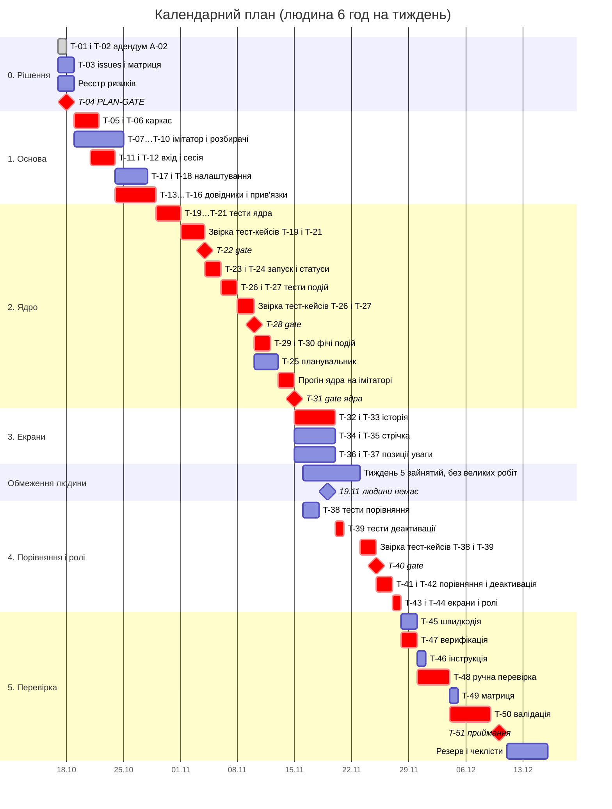

# Календарний план

| Поле | Значення |
|---|---|
| Статус | чернетка агента, на рев'ю людини |
| Джерело | `docs/tickets.md` (51 тікет, етапи 0–5) з урахуванням адендума A-02 (SRS 1.7) |
| Старт | 2026-10-19, після PLAN-GATE (T-04) |
| Час людини | 6 год на тиждень |
| Орієнтир | середина грудня 2026 (кінець семестру) |
| Результат | базове завершення 2026-12-10, з резервом і чеклістами — 2026-12-15 |

## Припущення

- 6 год на тиждень — це приблизно 3 слоти по 2 год. Дати календарні, вихідні не виключено.
- Агент працює лише в сесії, яку запускає людина. Test і Feature роблять різні сесії (правило плану
  тікетів). Час агента — тривалість сесії. Людина під час сесії не потрібна, тож цей час не входить
  у її 6 год.
- Час людини на тікет агента включає запуск сесії, рев'ю `git diff`, прогін тестів і коміт.
- Точність оцінок ±30 %. Повернення з gate в оцінки не входять, на них закладено резерв.
- Рішення PLAN-GATE (`docs/risk-register.md`, розділ «Рішення людини на PLAN-GATE»):
  - чеклісти людини (заходи 13–20 реєстру ризиків) забирають близько 2,5 год колишнього
    резерву 6 год; на повернення з gate лишається близько 3,5 год. Базові дати чеклістів не
    враховують, їх покриває вікно резерву;
  - тиждень 5 (2026-11-16…11-22) зайнятий, 2026-11-19 людини немає. На цей тиждень не ставлять
    великих робіт людини (звірка тест-кейсів, T-48, T-50); у ньому лише рев'ю тікетів етапів 3–4,
    а вільні 1,5 год — частина резерву. Звірка T-40 переходить на тиждень 6, тому T-40 і все
    після нього зсувається на 2 дні.
- Етап 0: T-01 і T-02 виконано 2026-10-17. До T-04 треба закрити T-03 (разом зі створенням issues)
  і реєстр ризиків `docs/risk-register.md` (окрема сесія агента), а сам T-04 — до 2026-10-18. Це
  близько 4 год людини поза бюджетом з 2026-10-19. Якщо T-04 зсувається, увесь план зсувається на
  стільки ж.

## Етапи, залежності, тривалості

| Етап | Тікети | Починається після | Агент, год | Людина, год | Тижнів людини | Дати |
|---|---|---|---|---|---|---|
| 0. Рішення щодо плану | T-03, реєстр ризиків, T-04 | T-02 | 1,5 | ≈4 | — | 2026-10-17…10-18 |
| 1. Основа | T-05…T-18 | T-04 | 10 | 8,25 | 1,4 | 2026-10-19…10-28 |
| 2. Ядро оновлення і стрічки | T-19…T-31 | T-16, T-10, T-18 | 14 | 15,5 | 2,6 | 2026-10-29…11-15 |
| 3. Екрани перегляду | T-32…T-37 | T-31 | 4,5 | 3 | 0,5 | 2026-11-15…11-20 |
| 4. Порівняння, деактивація, ролі | T-38…T-44 | T-31; T-39 також після T-33, T-35, T-37 | 6,5 | 6,5 | 1,1 | 2026-11-16…11-28 |
| 5. Перевірка і приймання | T-45…T-51 | T-44; T-46 також після T-25 | 4 | 10,25 | 1,7 | 2026-11-28…12-10 |
| **Разом, етапи 1–5** | 47 | | **39** | **43,5** | **7,3** | |
| Чеклісти людини (заходи 13–20 реєстру ризиків) | — | | — | ≈2,5 | 0,4 | у вікні резерву |
| Резерв на повернення з gate | — | | ≈4 | ≈3,5 | 0,6 | 1,5 год у тижні 5; решта 2026-12-11…12-15 |

### Оцінки за групами тікетів

| Етап | Група | Тікети | Агент, год | Людина, год | Що робить людина, крім рев'ю |
|---|---|---|---|---|---|
| 1 | Каркас | T-05, T-06 | 1 | 1,5 | погоджує залежності, зокрема `tzdata`, коміти `chore:` |
| 1 | Імітатор | T-07, T-08 | 1,5 | 1 | |
| 1 | Розбирачі | T-09, T-10 | 1,5 | 1 | |
| 1 | Вхід і сесія | T-11, T-12 | 1,5 | 1,5 | перевіряє, що в diff немає паролів і секретів |
| 1 | Довідники | T-13, T-14 | 1,5 | 1 | |
| 1 | Прив'язки | T-15, T-16 | 2 | 1,5 | |
| 1 | Налаштування | T-17, T-18 | 1 | 0,75 | |
| 2 | Тести ядра | T-19, T-20, T-21 | 4 | 2,75 | |
| 2 | **Gate T-22** | — | — | 3 | звіряє тест-кейси T-19 і T-21 з критеріями і BDD |
| 2 | Запуск і статуси | T-23, T-24 | 3,5 | 1,75 | |
| 2 | Планувальник | T-25 | 2 | 1 | |
| 2 | Тести подій | T-26, T-27 | 2 | 1,25 | |
| 2 | **Gate T-28** | — | — | 2,5 | звіряє тест-кейси T-26 і T-27 |
| 2 | Фічі подій | T-29, T-30 | 2,5 | 1,25 | |
| 2 | **Gate T-31** | — | — | 2 | переглядає прогін на імітаторі в усіх режимах |
| 3 | Історія | T-32, T-33 | 1,5 | 1 | |
| 3 | Стрічка | T-34, T-35 | 1,5 | 1 | |
| 3 | Позиції, що потребують уваги | T-36, T-37 | 1,5 | 1 | |
| 4 | Тести порівняння і деактивації | T-38, T-39 | 2 | 1,5 | |
| 4 | **Gate T-40** | — | — | 2,5 | звіряє тест-кейси T-38 і T-39 |
| 4 | Порівняння і деактивація | T-41, T-42 | 3 | 1,5 | |
| 4 | Екрани і ролі | T-43, T-44 | 1,5 | 1 | |
| 5 | Швидкодія та інструкція | T-45, T-46 | 1,5 | 1 | |
| 5 | Верифікація | T-47 | 1,5 | 1 | |
| 5 | Ручна перевірка | T-48 | 0,5 | 3 | перевіряє в Chrome і Firefox, заповнює протокол |
| 5 | Матриця | T-49 | 0,5 | 0,25 | |
| 5 | **Валідація** | T-50 | — | 4 | проходить UC-01…UC-16 у двох ролях |
| 5 | **Gate T-51** | — | — | 1 | рішення про приймання |

### Час людини за видами робіт

| Вид | Тікети | Год | Частка |
|---|---|---|---|
| Рев'ю diff, прогін тестів, коміти | 40 тікетів агента (етапи 1–4, T-45, T-46, T-47, T-49) | 25,5 | 59 % |
| Звірка тест-кейсів | T-22, T-28, T-40 | 8 | 18 % |
| Gate без звірки | T-31, T-51 | 3 | 7 % |
| Ручна перевірка в браузерах | T-48 | 3 | 7 % |
| Валідація | T-50 | 4 | 9 % |
| **Разом** | | **43,5** | 100 % |

## Діаграма Ганта

Позначка `crit` — критичний шлях. Gate показано як milestone. Перед gate T-22, T-28, T-40 і T-31
стоїть смуга роботи людини, з якої складається рішення gate.

## Критичний шлях

T-04 → T-05 → T-06 → T-11 → T-12 → T-13 → T-14 → T-15 → T-16 → T-19 → T-20 → T-21 → **T-22** →
T-23 → T-24 → T-27 → **T-28** → T-29 → T-30 → **T-31** → T-32 → T-33 → T-39 → **T-40** → T-41 →
T-42 → T-43 → T-44 → T-47 → T-48 → T-50 → **T-51**

На шляху 31 тікет. Вони займають 35,25 год людини з 43,5 (81 %) і близько 26 год агента.

**Чому саме він:**

1. **Етап 1.** T-14 чекає і на T-13, і на T-10. Гілка через вхід (T-06 → T-11 → T-12 → T-13) на один
   тікет довша за гілку імітатора (T-07 → T-10), тому імітатор, розбирачі й налаштування
   (T-17, T-18) мають запас.
2. **Етап 2 — найдовший відрізок.** Тест → gate → фіча послідовні навмисно: тести пишуться до коду, а
   фічу блокує gate. Тут два gate підряд (T-22, T-28) і ще T-31. T-27 чекає і T-24, і T-26, тому
   T-26 теж майже на шляху. T-25 на шлях не потрапляє: він потрібен лише T-31, і запас у нього
   дорівнює тривалості T-27…T-30, близько 5 днів.
3. **Етапи 3–4.** T-39 чекає всіх трьох пар екранів і T-38. Пари однакові за тривалістю, а T-38
   коротший. На шляху будь-яка з пар, у діаграмі це T-32 і T-33. Далі ланцюжок T-40 → T-41 → T-42 →
   T-43 → T-44 строго послідовний.
4. **Етап 5.** T-47 → T-48 → T-50 забирає 8 год людини, а T-45 → T-46 → T-49 — близько 1,25 год.
   Тому швидкодія, інструкція і матриця мають запас.

**Що це означає для календаря.** Майже кожен тікет чекає на одну людину. Тікети поза шляхом (близько
8 год) беруть ті самі 6 год на тиждень. Паралельні сесії агента календар не скорочують: вони лише
дають агентові працювати, поки людина зайнята gate. Тому тривалість приблизно дорівнює сумі годин
людини, поділеній на 6.

## Вузьке місце: людина

- **Календар задають години людини.** Людині потрібно 43,5 год, це 7,3 тижня. Агентові потрібно
  близько 39 год, але він працює без участі людини, між її слотами. Якби людина працювала повний
  день, критичний шлях зайняв би близько 61 год (26 агента + 35 людини), тобто 1,5–2 тижні.
- **Найбільша частка часу людини — рев'ю diff** (25,5 год), а не gate. Найбільші окремі роботи —
  T-50 (4 год), T-22 і T-48 (по 3 год), T-28 і T-40 (по 2,5 год). Кожна займає приблизно пів тижня,
  і жодну не можна передати агентові.
- **Агент гальмує лише місцево.** Послідовна сесія від 1,5 год (T-19, T-21, T-23, T-24, T-25, T-30,
  T-41, T-42, T-47), запущена посеред 2-годинного слоту, забирає весь слот. Правило: такі сесії
  запускати наприкінці слоту, а рев'ю робити на початку наступного.
- **Повернення з gate** коштує 1,5–2 год людини і один слот затримки. Після рішення PLAN-GATE
  резерву на повернення лишилося близько 3,5 год — приблизно на 2 повернення.

## Тижні і контрольні дати

| Тиждень | Дати | Людина, год | Закрити до кінця тижня | Контрольна дата |
|---|---|---|---|---|
| 1 | 2026-10-19…10-25 | 6 | T-05…T-13, T-17 | — |
| 2 | 2026-10-26…11-01 | 6 | T-14, T-15, T-16, T-18, T-19, T-20, T-21; почати звірку T-22 | — |
| 3 | 2026-11-02…11-08 | 6 | T-22, T-23, T-24, T-26, T-27; почати звірку T-28 | T-22 — 2026-11-04 |
| 4 | 2026-11-09…11-15 | 6 | T-28, T-29, T-30, T-25, T-31 | T-28 — 2026-11-10, T-31 — 2026-11-15 |
| 5 | 2026-11-16…11-22 | 6, тиждень зайнятий, 19.11 людини немає: 4,5 рев'ю + 1,5 резерву | T-32…T-39; звірку T-40 не починати | — |
| 6 | 2026-11-23…11-29 | 6 | T-40…T-44; почати T-45…T-47 | T-40 — 2026-11-25 |
| 7 | 2026-11-30…12-06 | 6 | T-45…T-47, T-48, T-49, початок T-50 | — |
| 8 | 2026-12-07…12-13 | 3,25 + 2,75 резерву й чеклістів | T-50, T-51 | T-51 — 2026-12-10 |
| 9 | 2026-12-14…12-20 | 1,75 резерву й чеклістів | — | межа з резервом — 2026-12-15 |

**Керування:**

- Відставання рахувати в годинах людини: 6 год відставання — це тиждень.
- Після кожного gate звіряти фактичну дату з контрольною. Якщо T-31 пройдено пізніше
  2026-11-19, резерв вичерпано, і 2026-12-15 без додаткових годин недосяжне. Що робити в такому
  разі, вирішує людина.
